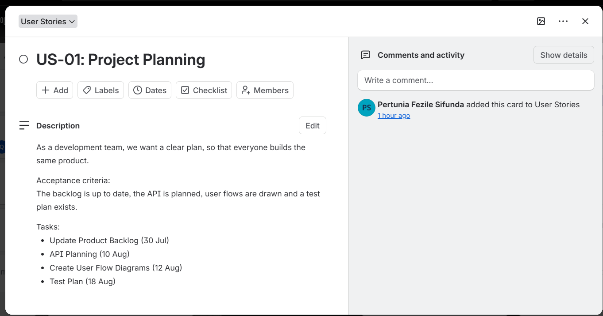
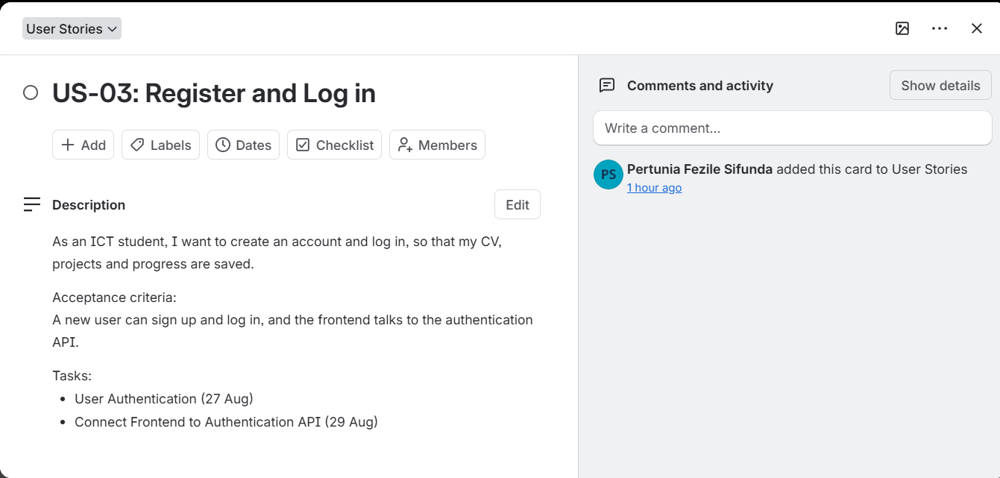
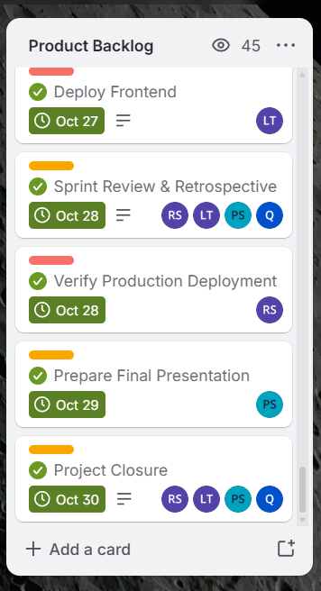
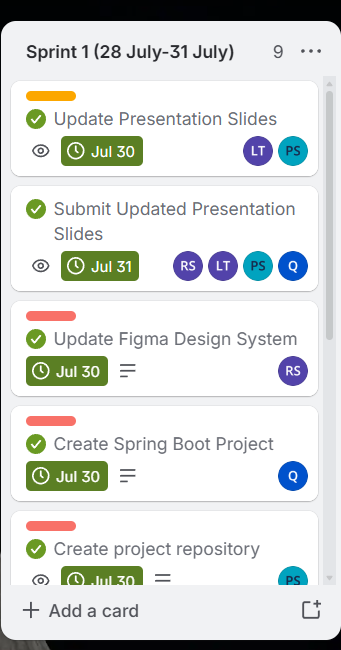
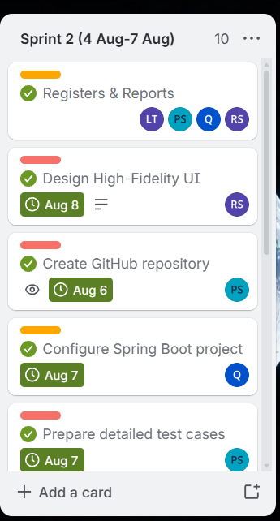
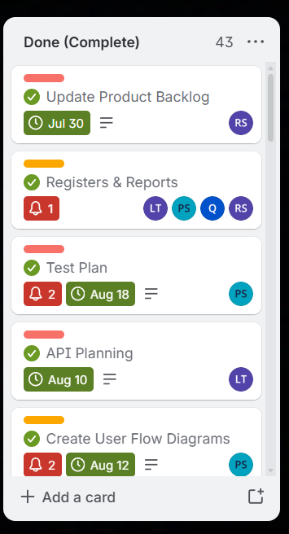

# 🌸✨ LaunchPad.dev — Agile Portfolio

**A student-focused career acceleration platform**  
*Helping final-year ICT students & graduates in Cape Town go from classroom → career*

[🌐 Live Application](https://launchpad-ev-production.up.railway.app/) · [📋 Team Charter](assets/evidence/team-charter/Agile%20Team%20Charter.pdf)

---

*Cute. Clean. Evidence-based. Built with 💜 and a whole lot of stand-ups.*

---

## 🌷 About This Portfolio

Welcome to my **PRP372S Project Presentation 3** digital portfolio!  

This living document showcases how our team applied **Agile principles** (Kanban + Scrum ceremonies) to design, validate, and prototype **LaunchPad.dev** — a career acceleration platform for ICT students.

Every section below contains:
- 🖼️ **Evidence** — real artefacts (Trello cards, screenshots, documents, logbooks)
- 🌟 **Reflection** — written using the **STAR method** so you can clearly see the Situation → Task → Action → Result journey

> “Individuals and interactions over processes and tools” — we lived this.

---

## 📑 Table of Contents

1. [🚀 Agile Team Charter](#-agile-team-charter)
2. [📝 User Stories & Tasks](#-user-stories--tasks)
3. [📦 Product Backlog](#-product-backlog)
4. [🏃 Sprint Backlog](#-sprint-backlog)
5. [📔 Agile Logbook](#-agile-logbook)
6. [🎯 Final Reflection & Learning](#-final-reflection--learning)

---

## 🚀 Agile Team Charter

### 🖼️ Evidence

Our living Agile Team Charter acted as the **social contract** for the entire July–October 2026 journey.

**Key elements included:**
- Clear Team Purpose & Vision for LaunchPad.dev
- Defined roles (Agile Lead, Technical Lead, Research Lead, Marketing Lead)
- Ways of Working (Kanban board columns + WIP limits)
- Ceremonies schedule (Daily Stand-up, Sprint Planning, Review, Retrospective)
- Working Agreements & Communication Plan
- Definition of Done
- Core Values + Risks & Mitigations

📄 **[View Full Agile Team Charter (PDF)](assets/evidence/team-charter/Agile%20Team%20Charter.pdf)**

📌 Quick peek at our team structure

| Name                  | Role                          |
|-----------------------|-------------------------------|
| Reotshepile Stock     | Agile Lead (Scrum Master)     |
| Lucky Twala           | Technical & Feasibility Lead  |
| Qhubekani Shandu      | Developer / Research Lead     |
| Pertunia Sifunda      | Analyst / Marketing Lead      |

### 🌟 Reflection (STAR Method)

**Situation**  
At the start of the WIL project we were four students with different strengths, schedules, and communication styles. Without a shared agreement we risked unequal participation, missed deadlines, and scope creep — common pitfalls in student teams.

**Task**  
I needed to help create (and later live by) a Team Charter that would act as our north star: defining purpose, roles, working agreements, decision-making, and a clear Definition of Done so that every card moved to “Done” actually meant something.

**Action**  
We co-created the charter collaboratively. I contributed to the Ways of Working section (Kanban columns + WIP limits of 2 cards per person), the communication norms (Teams + WhatsApp response times), and the risk register. We made the document a living artefact — we revisited it after every retrospective and updated ownership and milestones when reality shifted.

**Result**  
The charter dramatically reduced friction. Stand-ups stayed focused, blockers were raised within 24 hours, and we achieved 100% participation evidence on Trello. When lecturer feedback required design changes, the charter’s “responding to change” principle made adaptation feel natural instead of chaotic. The document remains one of the artefacts I’m proudest of because it turned a group of individuals into a real Agile team.

---

## 📝 User Stories & Tasks

### 🖼️ Evidence

We wrote user stories from the end-user’s perspective (ICT student / graduate) and broke each into concrete, estimable tasks with acceptance criteria.

**Sample stories captured on Trello:**

- **US-01: Project Planning** — “As a development team, we want a clear plan, so that everyone builds the same product.”
- **US-02: Technical Foundation** — Database + Spring Boot setup
- **US-03: Register and Log in** — Authentication flow
- … up to US-18 covering Portfolio Builder, Mock Interview Arena, Mentor Matching, and CV/GitHub Audit features

📁 **Full evidence folder:** [assets/evidence/user-stories/](assets/evidence/user-stories/)

### 🌟 Reflection (STAR Method)

**Situation**  
Early on we had a strong product idea but tasks were still high-level (“build the portfolio feature”). This made it hard to know when something was truly finished and caused uneven workload distribution.

**Task**  
Break every feature into INVEST-style user stories, attach clear acceptance criteria, and decompose them into small tasks that could be completed within a few days and tracked on our Kanban board.

**Action**  
I actively participated in story-writing workshops. For each story I helped define acceptance criteria (e.g., “A new user can sign up and log in, and the frontend talks to the authentication API”). I then created or refined the related tasks (Update Product Backlog, API Planning, Create User Flow Diagrams, Test Plan, etc.) and made sure every card had an owner, due date, and checklist.

**Result**  
By the time we reached Sprint 3 the board was transparent. Everyone knew exactly what “done” looked like for authentication, wireframes, and the portfolio builder. This clarity directly improved our velocity and reduced last-minute surprises before demos. Writing stories from the *student’s* perspective also kept us user-centred instead of feature-obsessed.

---

## 📦 Product Backlog

### 🖼️ Evidence

Our Product Backlog is a prioritised, living list of everything needed to deliver LaunchPad.dev — features, technical work, research, documentation, and final presentation tasks.

It evolved continuously as we validated the idea with real ICT students and received lecturer feedback.

📁 **Evidence folder:** [assets/evidence/product-backlog/](assets/evidence/product-backlog/)

Key screenshots:

*(Also includes Product_BacklogVid.mp4 showing the live Trello walkthrough)*

### 🌟 Reflection (STAR Method)

**Situation**  
At the beginning the backlog was a simple list of ideas. As research findings and lecturer feedback arrived, new items appeared and priorities shifted (e.g., visual design needed major refinement after an early review).

**Task**  
Maintain a prioritised Product Backlog that reflected current value, technical risk, and learning, while keeping it transparent to the whole team and our lecturer.

**Action**  
I regularly refined the backlog with the team: moving high-priority items to the top, splitting large items, adding new research-driven stories, and archiving completed work. We used the charter’s Definition of Done as the filter for what could leave the backlog. Screenshots and a short video walkthrough were captured so the evolution is visible.

**Result**  
The backlog stayed healthy and realistic. We never felt overwhelmed by an endless list because prioritisation was continuous. When the final deployment and pitch approached, the top of the backlog clearly showed exactly what still needed to be finished — giving us calm, focused sprints instead of panic.

---

## 🏃 Sprint Backlog

### 🖼️ Evidence

Each Sprint Backlog was a real-time, actionable plan pulled from the Product Backlog. We used short sprints (usually 4 days) aligned with our academic calendar.

Examples of sprint focus:
- **Sprint 1** (28–31 July): Project repository, Spring Boot setup, Figma design system, presentation updates
- Later sprints: Wireframe refinement, authentication, portfolio features, deployment, final polish

📁 **Full Sprint evidence:** [assets/evidence/sprint-backlog/](assets/evidence/sprint-backlog/)

### 🌟 Reflection (STAR Method)

**Situation**  
With four team members juggling multiple subjects, long “big-bang” planning sessions didn’t work. We needed short, focused sprints that still delivered visible progress every week.

**Task**  
Create and actively manage Sprint Backlogs that were realistic for our capacity, clearly owned, and visible on Trello so progress (and blockers) were obvious at every stand-up.

**Action**  
During Sprint Planning I helped select the highest-priority items from the Product Backlog that fit our WIP limits and remaining capacity. I broke work into cards that could realistically be finished in the sprint window, assigned owners, and added checklists. Mid-sprint I updated cards daily and flagged risks early (e.g., time pressure from other modules).

**Result**  
We consistently moved cards from “In Progress” → “Review” → “Done”. The visual nature of the Sprint Backlogs made it easy to celebrate small wins and quickly re-plan when a design change was requested. By the final sprints we had a smooth rhythm and a deployed application ready for the pitch.

---

## 📔 Agile Logbook

### 🖼️ Evidence

The Agile Logbook was our personal + team tracking tool. It captured:
- Daily stand-up answers (What I completed / What I’m planning / Impediments)
- Taskboard walkthroughs
- Retrospective insights
- Weekly reflections

I maintained entries across the entire project period (July – October 2026).

📁 **All logbook entries:** [assets/evidence/logbook/](assets/evidence/logbook/)

Sample themes that appear repeatedly:
- Prototyping & refining wireframes after lecturer feedback
- Creating the GitHub repository and adding collaborators
- Design system updates and colour scheme improvements
- Preparing presentations and final deployment tasks
- Honest recording of time-management challenges

### 🌟 Reflection (STAR Method)

**Situation**  
Agile ceremonies only create value if the conversations are captured and acted upon. Without a logbook, insights from stand-ups and retrospectives would disappear after the meeting ended.

**Task**  
Keep a consistent, honest Agile Logbook that recorded daily progress, impediments, and learning so that patterns (both positive and negative) became visible over the months.

**Action**  
I treated the logbook as a non-negotiable habit. After every stand-up I wrote what I completed, what I planned next, and any blockers (including personal ones such as competing subject deadlines). When the lecturer said our wireframes needed a more appealing colour scheme, I recorded the feedback, the redesign actions, and the outcome. I also noted team process improvements that came out of retrospectives.

**Result**  
The logbook became powerful evidence of continuous improvement. Looking back, I can see how we went from “time management is hard” to “we flag risks 48 hours early”. It also proved full participation and gave me concrete stories for this portfolio. Most importantly, writing reflections weekly trained me to think critically about my own process — a skill I will take into every future team.

---

## 🎯 Final Reflection & Learning

Building LaunchPad.dev under real Agile practices taught me far more than any textbook could.

**What I’m most proud of:**
- Turning a fuzzy idea into a **deployed, working prototype**
- Learning to write user stories that actually guide development
- Experiencing the power of a living Team Charter and honest logbooks
- Improving visual design through iterative feedback loops

**Key personal growth:**
- I became much better at raising blockers early instead of struggling silently
- I learned that “done” must be defined together — otherwise everyone has a different picture
- I discovered I enjoy the facilitation and clarity work of Agile ceremonies as much as the hands-on design & prototyping

This portfolio is not just evidence for a mark — it is a record of how a small student team became a high-functioning Agile unit.  

Thank you for reading 💜

---

**Made with ✨, Trello cards, many stand-ups, and a little bit of magic**

*PRP372S · Cape Peninsula University of Technology · October 2026*

[🌐 Live App](https://launchpad-ev-production.up.railway.app/) · [📄 Team Charter](assets/evidence/team-charter/Agile%20Team%20Charter.pdf)

